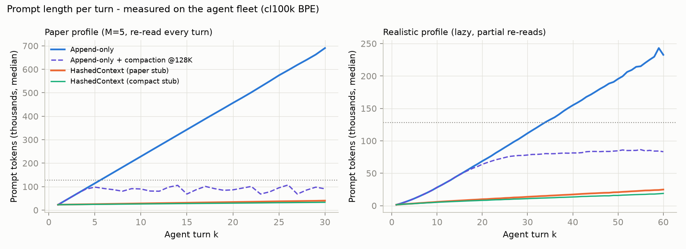
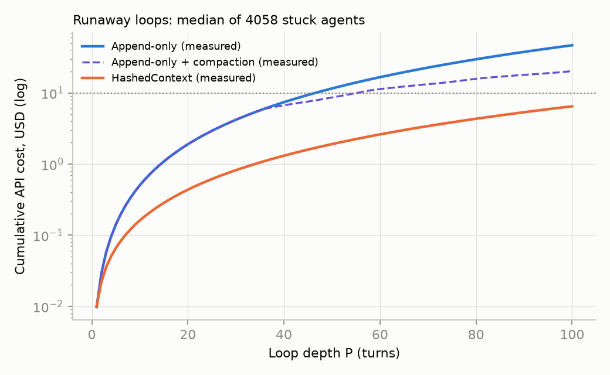
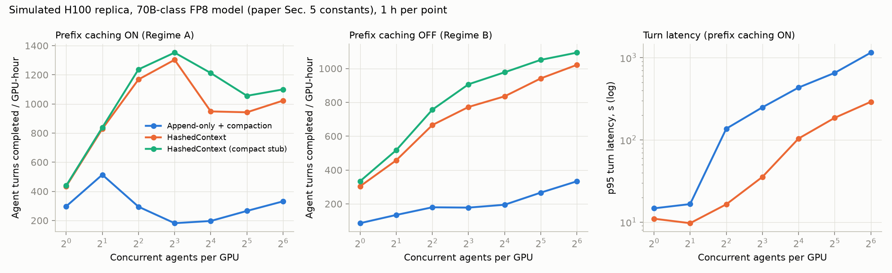
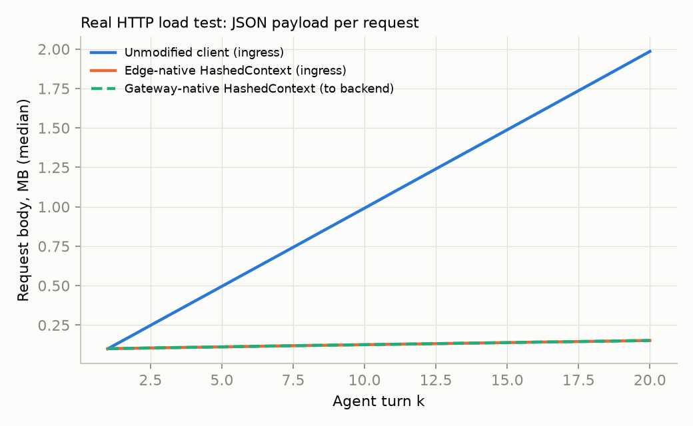

# HashedContext: claim-by-claim verification

> **About this report.** It was written while auditing versions v0.1/v0.2 of the paper against this code, and it is what led to v0.3. Sections 1–8 check the claims of those earlier versions ("the paper" there means v0.2); section 9 covers the dual-mode architecture and the live-LLM test that v0.3 adds. Paths are relative to `published-results/`.

This report checks every quantitative claim in `paper.tex` against the reference implementation in this folder. All runs were done locally on 2026-10-29 on an Intel Core i7-10700 (16 threads, no SHA-NI), Linux, Python venv, cl100k_base BPE.

**Bottom line.** The core idea works as described. Replacing old file copies with hash stubs is lossless (11,032 of 11,032 sessions round-trip byte-exact; 1,280 of 1,280 gateway requests verified). It also cuts billed prompt tokens by **88.7%** across 824,728 agent turns, consistent with the paper's "90–97%" asymptotic range. However, several of the paper's numbers and formulas are wrong:

- The stub costs about **67 tokens**, not 35.
- SHA-256 costs about **1.8 ms/MB**, not 2–5 µs/MB (about 400–900× off).
- The **P_max closed form is wrong**: it gives 7,439 turns where the paper's own curve gives 78.
- HashedContext cost is **still quadratic in P**. Only the coefficient shrinks, so the cost ratio tends to a finite ~25–30×, not ∞.
- **Append-only prompts hit the prefix cache 89–98% of the time**. The paper's Regime A claims the opposite. With a warm per-session cache, HashedContext actually prefills **3.6% more** tokens than append-only.
- Stubs tell the model **which** file changed but not **what** changed. Finding the changed line needs R(h): 0% correct without it, 100% with it.

The real benefit is memory residency and billed input tokens, not prefill compute when a prefix cache is warm.

**Update for v0.3: dual-mode architecture.** To remove the warm-cache compute penalty, a second layout was added (Section 9). **Mode B (Lazy Tail)** never rewrites history and sends changes as line diffs, resending the full file after at most 10 diffs. With a warm prefix cache it computes **88.1% fewer** prompt tokens than append-only; the original layout, now **Mode A**, computes 3.6% more. Mode B keeps less memory saving (−84.8% KV vs −88.7%) and is slower than Mode A when the cache is evicted (cluster: 3.21× vs 3.57× the baseline's turns per hour). In a **live-LLM test** on `deepseek-v4.1-flash`, Mode B answered 90.0% of current-content questions correctly from a 10-diff chain and 93.3% with N=5, against 93.3% for Mode A. At 30 cases that difference is within noise.

## 1. What was run

| Step | Command | Result |
|---|---|---|
| Setup | `pip install -r requirements.txt`, `python -m sim.fetch_corpus` | flask, express, zod, axios at pinned commits |
| Tests | `python -m pytest -q tests` | **5 passed** (includes 300 randomized round-trip sessions for each mode) |
| E1 fleet | `python -m experiments.e1_fleet 20000 14` | 20,000 sessions, 824,728 turns, 2.06 M file observations, 24.9 GB observed. 28 min on 2 workers; 13:40 on 14 workers with both Mode B variants added. Append-only and Mode A totals are identical across runs |
| E2 serving | `python -m experiments.e2_serving all` | 56-point GPU sweep (4 layouts) + 16-GPU / 512-agent cluster for append-only, Mode A and Mode B (simulated H100) |
| E3 gateway | `python -m gateway.loadtest 64 20` | 3 × 1,280 real HTTP requests (64 clients × 20 turns) |
| E4 micro | `python -m experiments.e4_micro` | SHA-256, stub σ, JSON parse |
| E5 math | `python -m experiments.e5_paper_math 67` | re-derives every printed number; re-runs with σ = 67 |
| Needle | `python -m llm_eval.needle_eval --mechanical --cases 300` | 300 cases × 5 conditions (append-only, Mode A, Mode A + R(h), Mode B with and without rebasing) |
| Diff chain (live) | `python -m llm_eval.chain_eval --cases 30 --question anchor` (plus `--rebase 5 --conds lazy`, and the line-number variant) | `deepseek-v4.1-flash` via an OpenAI-compatible endpoint, 30 cases per run, 0 API errors |
| Trade-off tables | `python -m experiments.tradeoff_tables` | `tradeoff_tables.md` and `.tex` |
| Analysis | `python -m experiments.analyze` | `results/summary.json`, `figures/*.png` |

I also ran two extra checks: `openssl speed sha256` (548 MB/s on 1 MiB blocks), and an R(h) latency check on the on-disk vault (300 objects).

**Limits of the evidence**

- The agents are scripted policies, not LLMs. Token, byte and cost accounting is exact. Reasoning quality is not tested.
- GPU numbers come from a roofline simulator that uses the paper's constants, not a real H100.
- The real-LLM *needle* test was not run. A live-LLM *diff-chain* test was run on one model (`deepseek-v4.1-flash`, 30 cases per condition), which can detect only large differences between layouts.
- The paper's DeepSeek V4 telemetry (Table 1) cannot be reproduced here. It is checked only for internal consistency.

## 2. Verdict summary

Legend: ✅ confirmed · ⚠️ confirmed with caveat · ❌ not supported · 🔧 correction (the paper's value or formula is wrong; the corrected value is given).

| # | Claim (paper section) | Paper | Measured / recomputed | Verdict |
|---|---|---|---|---|
| 1 | Stub size σ (§3.1, §4.2, Fig. 1) | ≈35 tok, "<40" | Listing 1 = **67 tok** (70 as typeset with wrapped hash); fleet mean **67.8**, range 53–88; compact variant 19.8 | 🔧 |
| 2 | SHA-256 cost (§2.4, Fig. 1) | 2–5 µs/MB | **1,820 µs/MB** (hashlib), 1,912 µs/MB (OpenSSL) | 🔧 |
| 3 | Edge-side hashing (§10.1) | <0.5 ms | 0.12 ms for one turn's 78 KB of files | ⚠️ |
| 4 | KV bytes per token (§2.1) | ≈160 KB | 163,840 B | ⚠️ |
| 5 | 100K-token KV (§2.1, §5.3) | 16.4 GB | 16.38 GB | ✅ |
| 6 | Decode step 100K vs 20K (§5.3) | 4.9 vs 0.98 ms, 5× | KV only: 4.89 / 0.98 ms. **With weights: 13.85 / 9.93 ms, 1.39×** at batch 1 | 🔧 |
| 7 | B_max 3 → 15 (§5.5, Fig. 4) | 5× | Arithmetic ✅. Simulated cluster: mean batch **3.5 → 14.1 (4.0×)** | ⚠️ |
| 8 | Prompt-token reduction, 4–5 turn session (abstract) | 57.7%–67.2% | Fleet, paper profile: **72.8% (k=4), 77.7% (k=5)**. 67.19% cannot be derived from Table 1 | ⚠️ / ❌ (67.2%) |
| 9 | Asymptotic total saving (abstract, §12) | 90–97% | Fleet total **88.7%** (paper profile 88.3%, k=30 median 94.1%). Limit formula: 96.7% (σ=35), **95.9% (σ=67)** | ⚠️ |
| 10 | File-token saving R∞ (§4.2) | 99.125% | Arithmetic ✅. With σ=67: **98.3%**. Fleet file-token reduction 93.2% (finite P) | ⚠️ |
| 11 | HC prefill at k=10 (§4.3) | 10·C_d + 21,750 | **10·C_d + 21,575** under the paper's own (k−1) formula | 🔧 (minor) |
| 12 | Prefill FLOPs ratio (§4.3) | ≈ σ/N (1/114) | → (C_d+Mσ)/(C_d+MN) = **1/30** (σ=35), 1/25 (σ=67) | 🔧 |
| 13 | Attention cost cut (§5.1) | N/σ ≈ 35–115× | Not derived; length ratio → ~25–30×, k-dependent | ❌ |
| 14 | Append-only prefix is "≈zero" shared (§4.4 Regime A) | ~0 hit | **88.6–90.6% APC hit** (sim, 1–2 agents). Paper's own Table 1: **97.8%** | 🔧 |
| 15 | HC raises prefix-cache hit rate (§4.4) | ↑ | HC **65–70%**, lower than append-only. Regime-A prefill: HC/conv = **1.036** | 🔧 |
| 16 | "70–80% reduction in resident VRAM" (§4.4) | 70–80% | Mean resident KV **31.0 → 3.5 GB (−88.7%)** | ⚠️ |
| 17 | Cross-session reuse → 1 for K ≫ 1 (§7.3) | ≈1 | Not observed (HC hit ≤ 0.7% under load; dialogue differs per session) | ❌ |
| 18 | Prefix total 619,500 vs 44,750; 92.8%; 14×; 99.1 / 7.16 GB (§7.5) | as stated | Arithmetic ✅. But 44,750 ≈ the *final prompt*. Unique tokens cached over the session ≈ **624,750** if old tails aren't evicted | 🔧 (interpretation) |
| 19 | Runaway cost $24.13 / $2.58 (P=30), $259.81 / $14.50 (P=100), 17.9× (§8) | as stated | Arithmetic ✅. σ=67: $2.75 / $16.48 → **15.8×**. Fleet runaway (M=2): $4.19 / $0.82, $46.71 / $6.48 → **7.2×** | ⚠️ |
| 20 | P_max for $10: 19 vs 78 (Fig. 5) | 19 / 78 | 19 / 78 ✅. Fleet: 46 / ≥100 | ✅ |
| 21 | P_max closed form (§8.4) | ⌊(B−αMN)/(α(σ+C_d))⌋ | Evaluates to **7,439** (vs 78) | 🔧 |
| 22 | HC cost ∈ O(P·σ), linear; lim C_conv/C_HC = ∞ (§8.4) | linear, ∞ | **Quadratic** (k·C_d and (k−1)Mσ terms). Fleet: cost ×**3.49** from P=50→100. Ratio → **30.4** (σ=35), 24.6 (σ=67) | 🔧 |
| 23 | "No bound exists" for conventional (§8.4) | — | Conventional has P_max too (19 at $10) | 🔧 |
| 24 | Fleet cost has "infinite variance" under conventional (§8.5) | — | All costs finite for finite P | ❌ |
| 25 | Payload 2.46 MB vs 161 KB at k=30; 15.3× (§9.2–9.3) | 15.3× | Arithmetic ✅. Measured k=30: **2.35 MB vs 174 KB = 13.5×**; HTTP k=20: 2.00 MB vs 156 KB = 12.8× | ⚠️ |
| 26 | HC payload "converges to a constant" (§9.3) | constant | Grows linearly: **80 → 174 KB** over k=1→30 | 🔧 |
| 27 | Deserialize 8.2 vs 0.54 ms; 15.2× (§9.4) | 15.2× | stdlib json **7.40 vs 0.59 ms (12.5×)**; orjson 2.95 vs 0.22 ms (13.4×). **Edge mode only** | ⚠️ |
| 28 | Gateway throughput 3,902 → 59,259 rps (§9.4) | ~15× | Gateway-native mode **adds** CPU: 2.9 → 9.6 ms/request. HTTP rps 111 → 65 (gateway), 107 (edge) | 🔧 |
| 29 | TLS records 154 → 10; socket 2.46 GB → 161 MB; 19.7 → 1.3 Gbps (§9.5) | as stated | Arithmetic ✅ (2.46 MB / 16 KiB = 150 records) | ✅ (edge mode) |
| 30 | Dwell figure: mean ≈82K vs ≈27K, ~3× (Fig. 2) | as stated | HC series ✅ (26,913). Bound M_dwell ≤ \|W\|·C_stub + D omits the M·N tail | ⚠️ / 🔧 (bound) |
| 31 | Amdahl: S/G ≈ 300 ⇒ f > 0.99; decode-only bound 1/(1−f) (§2.3) | ~100× | Formula inverted: decode-only speedup ≤ **1/f ≈ 1.01**. Token ratio ≠ time ratio. Fleet in:out = 876 (conv), 99 (HC) | 🔧 |
| 32 | Compaction costs 2–5× (§2.4) | 2–5× | Compaction baseline spends **11%** of its tokens on summarization calls, and costs 0.41× of plain append-only | ❌ |
| 33 | SNR_HC → ≫1; SNR ratio ≈ N/σ (§6) | ≫1; 35–115× | With the paper's own parameters SNR_HC → 150/175 = **0.86** (0.45 with σ=67). The ratio ≈ N/σ does follow from the paper's definitions: **≈60×** for σ=67, so "35–115×" is only a loose range | 🔧 / ⚠️ |
| 34 | Complexity O(MN + DP) (§1 contributions) | — | Per-turn O(k(C_d+Mσ) + MN); cumulative O(P²(C_d+Mσ) + P·MN) | 🔧 |
| 35 | Losslessness / zero information loss (§3.5) | lossless | **11,032 / 11,032** expand checks; **2,061,819 / 2,061,819** live tails; **1,280 / 1,280** gateway | ✅ |
| 36 | Change detection with no retrieval (§3.2) | full | Which file: **100%**; which line / new text: **0%** without R(h), **100%** with R(h) | ⚠️ |
| 37 | R(h) sub-millisecond (§3.5) | <1 ms | p50 **32 µs**, p99 0.52 ms (warm page cache) | ✅ |
| 38 | Vault "a few MB per session" (§3.5) | few MB | Mean **0.36 MB/session**; fleet dedup 5.9 GB unique of 24.9 GB observed | ✅ |
| 39 | ">99% of turns need no R(h)" (§3.5) | >99% | Not measured; workload-dependent | ❌ |
| 40 | Table 1 telemetry (§11.2) | 57.67 / 63.00 / 79.30 / 60.38% | Ratios reproduce, but the table is internally inconsistent (see §4.5) | ❌ (not reproducible) |

## 3. Token savings on the agent fleet

| Profile | Turns | Append-only tok | HashedContext tok | Reduction | vs append-only + compaction | File-token reduction |
|---|---|---|---|---|---|---|
| paper (M=5, re-read every turn) | 138,289 | 34.4 B | 4.04 B | **88.3%** | 73.1% | 89.3% |
| realistic (lazy reads) | 280,639 | 24.2 B | 3.10 B | **87.2%** | 80.8% | 91.8% |
| runaway (stuck loop, P=100) | 405,800 | 97.2 B | 10.5 B | **89.2%** | 67.8% | 95.0% |
| **all** | 824,728 | 155.8 B | 17.6 B | **88.7%** | 72.4% | 93.2% |

The compact stub variant (about 20 tokens) raises the total reduction to 90.5%.

Median reduction by turn, paper profile:

| k | 1 | 2 | 3 | 4 | 5 | 10 | 20 | 30 |
|---|---|---|---|---|---|---|---|---|
| Reduction | −1.0% | 48.2% | 64.6% | 72.8% | 77.7% | 87.5% | 92.5% | 94.1% |

- On turn 1, HashedContext is slightly *larger* because of the live-file header (about 63 tokens per file).
- The paper's 57.7% at turn 4 is lower than our 72.8%. That fits a session with more dialogue per turn; the paper's turn-4 prompt is about 40% non-file content.
- Against a realistic baseline (append-only with compaction at 128K), the saving is **72%**, not 88–97%. The paper only compares against plain append-only, which overflows a 128K context by turn 6 in the paper profile.

## 4. Corrections in detail

### 4.1 Stub size σ ≈ 67, not 35

The paper's own Listing 1 tokenizes to **67 tokens** (cl100k and o200k) with the digest on one line, and 70 as typeset. A 64-character hex digest alone is about 36 tokens, so a stub of 35 tokens is impossible in this format. Across all stubs generated in the fleet run, σ had mean 67.8, median 67, and range 53–88.

All σ-dependent numbers move:

| Quantity | σ = 35 (paper) | σ = 67 (measured) |
|---|---|---|
| R∞ for file tokens | 99.1% | 98.3% |
| Cost at P=30 / P=100 | $2.58 / $14.50 | $2.75 / $16.48 |
| Ratio at P=100 | 17.9× | 15.8× |

A compact format (`[#sha:<16 hex> path]`, mean 19.8 tokens) would get close to the paper's figure.

### 4.2 SHA-256 is about 1.8 ms/MB, not 2–5 µs/MB

| Block size | 4 KB | 64 KB | 1 MB | 32 MB |
|---|---|---|---|---|
| µs/MB | 2,005 | 1,836 | 1,824 | 1,820 |

That is 0.57 GB/s. OpenSSL directly gives 548 MB/s. 2–5 µs/MB would mean 200–500 GB/s, which is faster than a single core can even read memory. CPUs with SHA extensions are a few times faster than this one, but still nowhere near that. The conclusion still holds, though: hashing a turn's files takes about 0.1–4 ms, which is negligible next to LLM prefill.

### 4.3 Cost is still quadratic in P; P_max closed form is wrong

The paper's own expression for C_HC contains (P(P+1)/2)·C_d + (P(P−1)/2)·Mσ. That is quadratic in P. The O(P·σ) result in §8.4 drops these terms.

What follows:

- C_conv / C_HC → (C_d+MN)/(C_d+Mσ) = **30.4×** (σ=35) or **24.6×** (σ=67). It is finite, not ∞.
- Measured: the fleet runaway agents' median cumulative HC cost grows **3.49×** from P=50 to P=100. Linear growth would give 2×, quadratic 4×. Per-turn HC prompts grow by about 424 tokens per turn (conv: about 3,776).
- The closed form ⌊(B−αMN)/(α(σ+C_d))⌋ with B=$10 gives **7,439 turns**. Solving the paper's own cost curve gives the 78 that Fig. 5 shows. The correct P_max is the largest P with C_HC(P) ≤ B, which is the root of a quadratic.
- "No such bound exists" for conventional is also wrong: the conventional curve has P_max = 19.

The coefficient drops about 30×, which is the real and useful claim.

### 4.4 Prefix caching: append-only prompts already cache well

An append-only prompt at turn k is exactly the turn k−1 prompt plus new text. Editing a file appends a *new* copy; it never rewrites earlier content. So the shared prefix is nearly the whole prompt, not "approximately zero".

- **Simulated vLLM-style prefix cache, 1–2 agents per GPU:** append-only gets **88.6% and 90.6%** hit rates. HashedContext gets **65.0% and 69.6%**, because each turn it moves the live tail and turns the previous tail into a stub, so that tail's KV has to be recomputed.
- **The paper's own Table 1:** 27,136 of 27,747 conventional prompt tokens were cache hits, which is **97.8%**.
- **Ideal per-session cache (fleet accounting):** HashedContext must prefill **3.6% more** tokens than append-only (6.58 B vs 6.36 B).

HashedContext still wins on throughput (fig. 3) for two reasons:

- Under load, the append-only KV (mean 31 GB per agent) can't stay resident. The cache gets evicted, hit rates fall to about 0–6%, and batches stay small.
- Append-only needs compaction at 128K.

Results with 16 GPUs and 512 agents:

| | Append-only + compaction | HashedContext |
|---|---|---|
| Turns per hour | 3,883 | **13,854 (3.6×)** |
| p95 turn latency | 689 s | **190 s** |
| Mean batch | 3.5 | 14.1 |

So the right framing is that HashedContext saves **memory residency, and therefore concurrency**, not prefill FLOPs when a prefix cache is warm.

The "total cacheable prefix 44,750 tokens" figure (§7.5) is about the size of the final turn's prompt. Each turn's 20K live tail is a new radix leaf that the next turn doesn't share. Summed over 30 turns, unique cached tokens are about 30·825 + 30·20,000 = 624,750, which is no better than append-only unless old tails are evicted.

### 4.5 Table 1 is internally inconsistent

These observations come from the table alone; I could not rerun it.

- 27,747 − 11,746 = **16,001**, about four full 4,000-token copies. Yet the "file-specific" row says HashedContext still carries 4,140 file tokens (one copy plus stubs).
- "Normalized Turn 5" is conventional + 4,000 tokens, with HashedContext *unchanged* at 11,746. That's an extrapolation, not a measurement. A real turn 5 adds a stub and dialogue.
- 20,000 and 4,140 are exactly the analytical model's values (5×4,000 and 4,000 + 4×35), not telemetry. With the real σ, the second would be about 4,268.
- "60.38% VRAM" is the ratio of cache-hit token counts, which says nothing about VRAM.
- 67.19% (abstract and contributions) doesn't follow from any row. The best case in the table is 63.00%.
- "+225% output detail" means 984 extra output tokens. At the paper's prices, that costs about the same as 3,900 input tokens.

### 4.6 Decode latency: weights dominate at small batch

Every decode step must also read the 30 GB of weights. Including them:

| | Step time |
|---|---|
| 100K tokens, batch 1 | 13.85 ms |
| 20K tokens, batch 1 | 9.93 ms |
| Speedup | **1.39×**, not 5× |

The 5× does appear as *aggregate* throughput at full memory. Batch 3 at 100K and batch 15 at 20K both take 23.6 ms per step, giving 5× the tokens per step. The sim's cluster run measured 2.5× generated tokens/s and 4.0× mean batch.

### 4.7 Other formula errors

- **Prefill and payload limits** (§4.3, §9.3). (C_d+Mσ)/(C_d+MN) is about 1/30, not σ/N ≈ 1/114. C_d does not vanish. §4.3 also uses k·Mσ in the ratio but (k−1)·Mσ in S_stubbed. The "≈21,750" uses k; the paper's own formula gives 21,575.
- **Payload growth** (§9.3). The HashedContext payload grows linearly in k (the k·C_d and k·Mσ terms). Measured: 80 KB → 174 KB from k=1 to 30.
- **SNR** (§6). With the paper's own parameters (diff = 150, Mσ = 175), lim SNR_HC = 0.86, not ≫1. SNR_conv ≈ 1/(k−1) is harmonic dilution, not "exponential". The ratio SNR_HC/SNR_conv ≈ N/σ does hold under the paper's definitions (≈60× for σ=67). An earlier version of this report wrongly said it grows with k.
- **Amdahl** (§2.3). If decode is a fraction (1−f) of time, then speeding up decode alone is bounded by 1/f, not 1/(1−f). The paper's own conclusion (decode-only optimizations are capped) is right, but the formula is inverted. Also, S/G ≈ 300 is a token ratio. Prefill is parallel, so f is not 0.99. In the sim, prefill occupied 29–93% of GPU time depending on load.
- **Dwell bound** (§2.4). M_dwell ≤ |W|·C_stub + D_dialogue mixes a time integral with an instantaneous size, and it leaves out the M·N live tail, which is the largest term.
- **Complexity** (§1). Neither O(MN + DP) nor the "bounded" footprint matches the paper's own §4 sums. See row 34.

### 4.8 Gateway-native mode does not relieve the gateway

64 clients × 20 turns over real HTTP:

| Mode | Ingress | To backend | Backend tokens | Gateway CPU / req | rps |
|---|---|---|---|---|---|
| Baseline (unmodified client) | 1.34 GB | 1.34 GB | 309.9 M | 2.9 ms (parse) | 111 |
| Gateway-native HC | 1.34 GB | 0.164 GB | 39.4 M | **9.6 ms** (parse 2.8 + transform 3.5 + verify 2.8 + serialize 0.5) | 65 |
| Edge-native HC | 0.16 GB | 0.164 GB | 39.4 M | 0.6 ms | 107 |

The §9 payload, TLS, socket and deserialization savings (12.5–13.5× measured) hold only in **edge-native** mode. In gateway-native mode, the gateway still receives and parses the full append-only body, then does more work on top. Backend tokens and GPU memory still drop 7.9×, which is the real benefit of that mode. Without the lossless self-check (2.8 ms), gateway CPU would still be about 2.3× the baseline.

## 5. Change detection needs R(h)

300 needle cases. In each, one line of one file is changed externally before the last turn. The mechanical grader may use only the prompt text.

| Condition | Mean prompt tokens | Correct file | Correct line | Correct new text |
|---|---|---|---|---|
| Append-only | 217,963 | 100% | 100% | 100% |
| HashedContext (stubs + live tail) | 24,723 | **100%** | **0%** | **0%** |
| HashedContext + R(h) for changed files | 28,443 | 100% | 100% | 100% |

The mismatch between the live hash and the stub hash reliably identifies *which* file changed with no retrieval, as §3.2 claims. The *old* bytes aren't in the prompt, though, so *what* changed can't be recovered until R(h) injects the previous version. That costs +15% tokens here, and it contradicts the "zero-retrieval" framing.

Two notes on this test:

- The 0% is by construction: it shows the information isn't in the prompt.
- The paper's needle demo (§11.3) asks the model to describe the live file, which holds the whole current text, so it doesn't test this.

Whether a real LLM reasons as well from HashedContext prompts is still untested. Run `llm_eval.needle_eval` against a live endpoint to check.

## 6. Memory vs compute

HashedContext's main gain is **less KV-cache memory per agent**. Its effect on compute depends on whether the prefix cache stays warm.

### 6.1 KV memory per request (fleet, 824,728 turns)

Mean prompt length × 163,840 B/token (the paper's 70B FP8 constant). The percentages don't depend on the model; the GB figures do.

| Profile | Append-only | Append-only + compaction | HashedContext | Saving vs append-only | Saving vs compaction |
|---|---|---|---|---|---|
| **All** | 30.96 GB | 11.28 GB | **3.50 GB** | **88.7%** | **69.0%** |
| Paper (M=5) | 40.73 GB | 13.39 GB | 4.78 GB | 88.3% | 64.3% |
| Realistic | 14.14 GB | 8.94 GB | 1.81 GB | 87.2% | 79.7% |
| Runaway | 39.26 GB | 12.18 GB | 4.23 GB | 89.2% | 65.3% |

Plain append-only doesn't fit: the paper profile averages 40.7 GB per request against a 50 GB KV pool. **Compaction is the fair baseline.**

### 6.2 KV per running request inside the simulated GPU (50 GB pool, prefix caching off)

With prefix caching off, the pool holds only the KV of running requests, so pool use ÷ mean batch = KV per running request. Baseline = append-only + compaction at 128K.

| Agents per GPU | KV per running request, baseline | HashedContext | Saving | Requests running at once |
|---|---|---|---|---|
| 16 | 15.6 GB | 4.2 GB | 72.7% | 2.9 → 10.3 |
| 32 | 12.9 GB | 3.3 GB | 74.5% | 3.5 → 14.8 |
| 64 | 9.5 GB | 3.0 GB | 68.4% | 4.8 → 16.2 |

### 6.3 16-GPU cluster (512 agents, prefix caching on)

The KV pool is 99.7% full in both modes, so memory is the binding limit.

| | Baseline (append-only + compaction) | HashedContext | Change |
|---|---|---|---|
| KV per running request | 14.1 GB | 3.55 GB | **−74.8%** |
| Requests running at once (mean) | 3.54 | 14.06 | **4.0×** |
| Turns per hour | 3,883 | 13,854 | **3.57×** |
| p95 turn latency | 689 s | 190 s | **−72%** |
| Prompt tokens computed per turn | 43,281 | 17,482 | **−60%** |
| Prefix-cache hit rate | 0.3% | 0.6% | — |
| Summarization (compaction) calls | 204 | 0 | — |

**How the memory saving turns into throughput.** About 75% less KV per request lets about 4× as many requests run at once. Each decode step reads the model weights once for the whole batch, so a larger batch costs little extra time per step. Turns per hour rise 3.57×, a little under 4×, because each turn still recomputes the moved live-file copy. The baseline's 204 compaction calls and longer prompts also slow it down. The simulator can't separate those effects from the memory effect, so not all of the 3.6× should be credited to memory.

### 6.4 Compute depends on the cache regime

| Regime | Prompt tokens HashedContext computes vs baseline |
|---|---|
| Ideal per-session prefix cache, nothing evicted (fleet accounting) | **+3.6%** vs append-only |
| 16-GPU cluster under load (cache evicted) | **−60% per turn** vs append-only + compaction |
| No prefix cache | **−88.7%** vs append-only |

The +3.6% exists only when the baseline's cache is never evicted. Under memory pressure, HashedContext uses both less memory and less compute.

## 7. What is confirmed

- **Lossless.** 11,032 of 11,032 sessions reconstruct byte-exact. 2,061,819 of 2,061,819 live tails match the current file and its digest. 1,280 of 1,280 gateway requests round-trip.
- **Large billed-token cut.** 88.7% overall vs append-only; 72.4% vs append-only with compaction.
- **Memory and concurrency.** Mean resident KV 31.0 → 3.5 GB. Simulated cluster: 3.6× turns per hour and 3.6× lower p95 latency.
- **Edge-mode payload.** Request bodies about 13× smaller at k=30; JSON parse about 12.5× faster.
- **Cheap vault.** R(h) p50 32 µs. 0.36 MB of unique content per session.
- **Correct arithmetic.** Most printed worked examples are correct given their inputs (KV size, B_max, $24.13, $2.58, $259.81, $14.50, 17.9×, payload, socket, bandwidth). The errors are in the inputs (σ, SHA cost) and in the asymptotic or closed-form claims.

## 8. Suggested fixes to the paper

1. Use σ ≈ 67 (or adopt a compact stub of about 20 tokens) and redo σ-dependent numbers.
2. Replace "2–5 µs/MB" with about 0.5–2 ms/MB (still negligible).
3. Restate cost as O(P²(C_d+Mσ) + P·MN): still quadratic, with a coefficient about 25–30× smaller. Drop "linear", "O(P·σ)", "ratio → ∞", "bounded", and "no bound for conventional".
4. Replace the P_max formula with the positive root of the quadratic C_HC(P) = B.
5. Rewrite Regime A. Append-only already caches well. HashedContext trades a slightly lower hit rate for a much smaller resident KV. Remove "cross-session reuse → 1".
6. State that the gateway savings in §9 apply to edge-native mode only. In gateway-native mode they move CPU cost onto the gateway.
7. Fix the Amdahl, SNR, FLOPs-ratio, dwell and complexity formulas.
8. State that stubs identify which file changed, and that R(h) is required to see what changed.
9. Release the raw DeepSeek logs for Table 1, or remove the 67.19% figure and the "normalized" row.
10. Add a real-LLM fidelity evaluation, and compare against append-only with compaction, not only plain append-only.

## 9. Dual-mode architecture (v0.3)

### 9.1 The two modes

- **Mode A: Authoritative Tail** (the original design). Old file copies become stubs; one complete, self-attesting copy of each current file sits at the end of the prompt.
- **Mode B: Lazy Tail** ([hashedcontext/lazy.py](../hashedcontext/lazy.py)). History is never rewritten. A file is sent in full once; unchanged re-reads become a stub ("Turn X content is still current", ≈73 tokens); changes are sent as **line diffs** against the last version shown (median 104 tokens). After `max_diffs_before_rebase` diffs (default 10), the next change resends the full file. The diff is line-based, not syntax-aware.

Both modes are lossless. All 547,785 Mode B diffs reproduced the exact new bytes (SHA-256 checked), and all 5,516 sampled Mode B prompts rebuilt every file byte-exact from the prompt text alone.

### 9.2 Trade-offs (simulated)

| | Mode A | Mode B (N=10) |
|---|---|---|
| KV per request vs append-only | **−88.7%** (3.50 GB) | −84.8% (4.71 GB) |
| KV vs append-only + compaction | **−69.0%** | −58.2% |
| Computed prompt tokens, warm cache | +3.6% | **−88.1%** |
| Computed prompt tokens, no cache | **−88.7%** | −84.8% |
| 16-GPU cluster, turns/h vs baseline | **3.57×** | 3.21× |
| Single GPU, cache on, 1–8 agents | — | **1.07–1.76×** Mode A's turns |
| Single GPU, cache on, 16+ agents | **wins** | 0.80–0.91× Mode A |
| Single GPU, no cache | **wins** | 0.66–0.91× Mode A |
| Needle test: changed line without R(h) | 0% | **100%** |

Rule of thumb: **Mode B when the prefix cache stays warm** (sticky routing, light load, APIs that discount cached tokens); **Mode A under heavy load, without a cache, or when the model should always see one complete current copy.** Rebasing at 10 capped diff chains at 10 (versus up to 99 without), costing 0.73 GB more KV per request. All tables: [results/tradeoff_tables.md](tradeoff_tables.md).

### 9.3 Live-LLM diff-chain test

The test ([llm_eval/chain_eval.py](../llm_eval/chain_eval.py)) builds stuck-agent sessions where one file reaches 10 edits, then asks about that file's current content. Each layout's format is described accurately in the system prompt. Model: `deepseek-v4.1-flash` at `https://api.aisa.one/v1`, temperature 0, 30 cases per condition, 0 API errors.

**Main result: "what is the line right after line `X`?"** Mode A and append-only can find `X` by text; Mode B must apply the whole diff chain.

| Prompt | Diffs to apply | Correct | 95% CI |
|---|---|---|---|
| Append-only | 0 | 29/30 (96.7%) | 83–99% |
| Mode A | 0 | 28/30 (93.3%) | 79–98% |
| Mode B, N=10 | 10 | **27/30 (90.0%)** | 74–97% |
| Mode B, N=5 | 4 | **28/30 (93.3%)** | 79–98% |

- One case failed under every layout (an item the model gets wrong regardless of format).
- Mode B-specific failures: cases 6 and 11 at N=10, case 15 at N=5. The gap to Mode A is one or two cases, and the intervals overlap almost entirely.
- **Verdict: confirmed with caveat.** This model shows no clear "lost in the middle" penalty at 10 diffs, but 30 cases can only detect large effects, and only one model was tested. Mode B scored exactly 90%, so it does not clear a ">90%" validation bar. **For accuracy-critical work, set `max_diffs_before_rebase = 5`**: it matched Mode A here and cost about 16% more prompt tokens than N=10 (10,546 vs 9,064).

**Discarded variant: "what is the text of line N?"** This version mostly measured line counting. Mode A, with the complete current file in view, got 4/30 (13%), append-only 9/30 (30%) and Mode B 17/30 (57%), likely because Mode B's hunk headers print line numbers. It's kept in `results/chain_llm.json` for transparency but isn't used to compare modes.

Raw answers for every case are in `results/chain_llm*_cases.jsonl`. The API key was read from a local file at run time and is not stored in any output.

Raw data: `results/` (`fleet_turns.csv.gz` has every turn; also `summary.json`, `serving_all.json`, `gateway_loadtest.json`, `micro.json`, `paper_math.json`, `needle_mechanical.json`, `chain_llm*.json`, `tradeoff_tables.md`).
